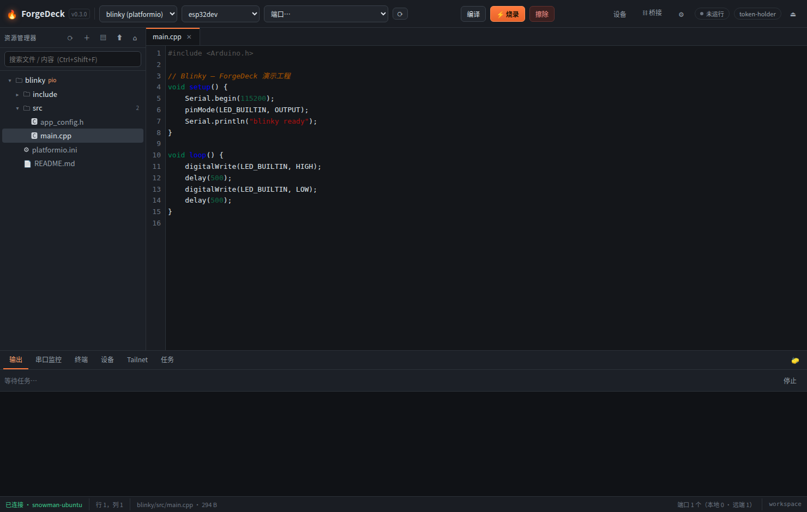
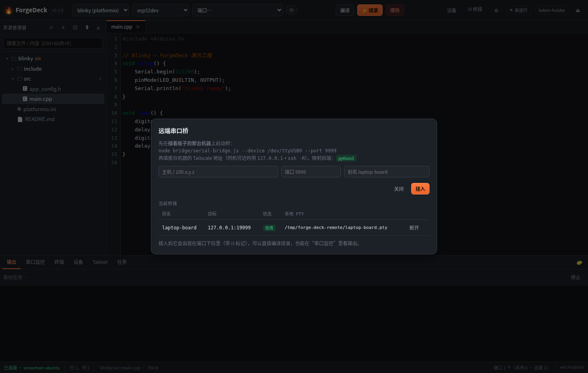
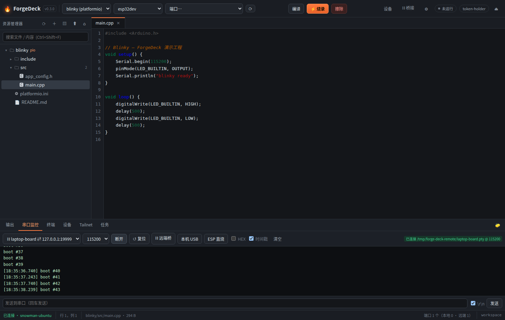

<div align="center">

# 🔥 ForgeDeck

**开发环境在远端服务器，板子在你手边 —— 浏览器里一样能烧。**

代码编辑 · 编译 · 烧录固件 · 串口监控 · 交互终端，全部通过 Tailscale（或一条 SSH 隧道）连接。

`零 npm 依赖` · `单进程` · `Node ≥ 18` · `MIT`

</div>

---

## 这是什么

ForgeDeck 由两个部分拼成一台"远端固件工作台"：

- **服务端**跑在一台长期在线的 Linux 机器上（树莓派、NAS、小主机、云上裸金属都行）：存放工程、跑 PlatformIO、执行烧录、开终端。
- **Bridge** 跑在插着开发板的你自己的电脑上：把 USB 串口变成网络上的一路字节流。
- **浏览器**（笔记本、平板、手机、借来的电脑）打开 `https://<机器名>.<tailnet>.ts.net`，编辑、编译、点烧录、看串口输出。

```
      ESP32 / STM32 / AVR / RP2040  ──── USB ──── 你的电脑
                                                    │
                                              serial-bridge（零依赖）
                                                    │  Tailscale 或 ssh -R
                                                    ▼
                    浏览器 ──https──▶  ForgeDeck 服务端（PlatformIO 等）
```

**关键在于方向**：板子不必插在服务器上，服务器也不必能碰到 USB。`USB → 你的电脑 → Tailscale → 服务器` 这条链就是 ForgeDeck 的全部想象力；没有 Tailscale 时，一条 `ssh -R` 也能把同样的端口搬过去。

## 三种接板子的方式

| | **A. bridge + Tailscale** | **B. ssh -R 隧道** | **C. Web Serial** |
|---|---|---|---|
| 做法 | 本机跑 bridge，服务端接 `100.x.y.z:9999` | 本机 bridge + `ssh -R 9999:localhost:9999` | 浏览器直接 `navigator.serial` |
| 需要装 | 本机 Node | 本机 Node + ssh | 只要 Chrome/Edge |
| 支持后端 | **全部**（PlatformIO/esptool/avrdude/st-flash/dfu/openocd） | **全部** | 仅 ESP（esptool-js） |
| 多人共享同板 | ✅ | ✅ | ❌ |
| 手机可用 | ✅ 看/发串口、触发烧录 | ✅ | ❌ |

推荐 **A**，网络受限用 **B**，临时救急用 **C**。细节见 [docs/remote-usb.md](docs/remote-usb.md)。

## 五分钟开始

**服务器端**：

```bash
git clone https://github.com/YOUR_GITHUB/forge-deck.git
cd forge-deck
bash scripts/install.sh        # 生成 config.json（随机令牌）、工作区、可选 systemd
node server/main.js            # http://127.0.0.1:8083
tailscale serve --bg http://127.0.0.1:8083   # → https://<机器名>.<tailnet>.ts.net
```

**插着板子的电脑上**（Linux/macOS，Node ≥ 18）：

```bash
node forge-deck/bridge/serial-bridge.js --list         # 找到 /dev/ttyUSB0
node forge-deck/bridge/serial-bridge.js --device /dev/ttyUSB0 --port 9999
```

**浏览器里**：打开上面的 https 地址 → 输入令牌 → 顶栏点 `⛓ 桥接` → 主机填那台电脑的 tailnet IP、端口 `9999` → 接入。

现在这块板子出现在端口下拉里（带 `⛓`），`编译` / `烧录` / `串口监控` 都直接对它生效。

## 界面

<table>
<tr>
<td width="50%"><br><em>文件树 + CodeMirror + 任务输出</em></td>
<td width="50%"><br><em>把本机 USB 接进远端工作台</em></td>
</tr>
<tr>
<td colspan="2"><br><em>接入后：串口监控直接读你电脑上那块板子的输出，烧录走同一个端口</em></td>
</tr>
</table>

## 能力清单

**编辑**
- 文件树（懒加载、右键重命名/删除/下载/另存为）、上传、内容搜索
- CodeMirror 5：多标签、未保存标记、`Ctrl+S`、C/C++/Python/JS/JSON/YAML/ini/shell/Markdown 高亮
- 组件加载失败自动降级为纯文本编辑（不白屏）

**构建与烧录**
- 统一任务模型 `build / flash / clean / erase / custom`，SSE 实时日志 + 任务历史 + 取消（SIGTERM→SIGKILL）
- 后端自动选择：`platformio.ini` → PlatformIO；`.ino` → arduino-cli；`Makefile` → make；也可在「⚙︎ 高级烧录」强制指定并给 `file` + `address`
- **端口来自任意来源**：服务器本地 `/dev/ttyUSB0`、bridge 映射的远端 PTY、`socket://host:port`

**远端桥（本机 USB 接入）**
- `bridge/serial-bridge.js`：零依赖单文件，Linux/macOS，支持多设备、多端口、拔插自愈
- 服务端把 TCP 映射成真 PTY（`socat` 或 python3 兜底），所以**所有烧录后端零改动**就能用
- 属性持久化：重启服务后桥接仍在，对端晚上线也会自动连上（PTY 连接最多重试 120s）
- 裸 TCP 也能直接给 PlatformIO：`--upload-port socket://host:9999`

**观察与操作**
- 串口：双向、波特率/HEX/时间戳/`\r\n`/DTR 复位；服务器串口与远端 PTY 用同一套代码
- 终端：`script(1)` 提供真 PTY（无 node-pty），xterm.js 渲染，可 resize
- 设备面板：`/dev/serial/by-id`、sysfs 厂商名、USB VID:PID → 型号推断（ST-Link/CH340/CP210x/ESP32 原生 USB/Pico/DFU/J-Link…）

**浏览器直连（Chrome/Edge）**
- `串口监控 → 本机 USB`：`navigator.serial` 直接拿当前设备的串口，不经过服务器
- `ESP 直烧`：esptool-js 在浏览器里写 ESP 固件（.bin + 地址）

**Tailnet**
- `/api/tailnet` 显示 MagicDNS、tailnet IP、在线设备与 `tailscale serve` 命令
- WhoIs 身份识别 + `allowUsers` / `allowTags` 白名单

## 支持的烧录后端

| 后端 | 目标 | 命令要点 |
|---|---|---|
| PlatformIO | ESP32/ESP8266/STM32/AVR/RP2040/… | `pio run -t upload --upload-port <port>` |
| esptool | ESP 系列 | `write_flash <addr> <file.bin>` |
| avrdude | AVR / Arduino | `-U flash:w:<file.hex>:i` |
| st-flash | STM32 (ST-Link) | `write <file.bin> 0x08000000` |
| dfu-util | STM32/Atmel DFU | `-s 0x08000000:leave -D <file>` |
| OpenOCD | 任意 JTAG/SWD | `-f <cfg> -c "program ... verify reset exit"` |
| arduino-cli | Arduino 草图 | `upload -p <port> --fqbn <env>` |
| picotool | RP2040 BOOTSEL | `load <file.uf2>` |
| make | 自定义 Makefile | `make flash` |

装了就出现在 `/api/backends`，没装的显示灰色不可用——不误导。

## 安全模型

- 服务端默认只监听 `127.0.0.1`，对外走 `tailscale serve`（自动 TLS）。不开口到公网。
- 令牌：`config.json` 的 `token` 或 `FORGEDECK_TOKEN`；登录后写 `HttpOnly` cookie。
- Tailnet 身份：来自 `100.64.0.0/10` 的请求可用 `tailscale whois` 反查用户/节点，`allowUsers`/`allowTags` 做白名单。
- 路径约束：所有文件操作解析到工作区根内，拒绝 `..`、软链、NUL；写入走临时文件 + rename。
- 命令执行：一律 `spawn` + 参数数组，不经 shell；`custom` 只接受显式 `argv`。
- **bridge 单独设防**：它暴露的是真实硬件读写权。默认 `--allow 100.64.0.0/10,127.0.0.1/32`，改动前先看看 Tailscale ACL。Web 令牌保护不了这层裸 TCP。
- 不想给 shell：`shell.enabled=false`；不想给全部串口：`serial.allowPorts`。

## 配置

```jsonc
{
  "host": "127.0.0.1",        // 想直接局域网裸连改 0.0.0.0（务必配 token）
  "port": 8083,
  "workspace": "./workspace",
  "token": "…",               // openssl rand -hex 32
  "tailscale": {
    "enabled": true,
    "whoisAuth": true,
    "allowUsers": [],          // ["you@example.com"]
    "allowTags": [],           // ["tag:lab"]
    "allowAnyTailnetDevice": true
  },
  "tools": { "pio": "", "esptool": "", "avrdude": "", "stflash": "st-flash", "dfuUtil": "dfu-util", "openocd": "openocd" },
  "serial": { "defaultBaud": 115200, "allowPorts": [] },
  "shell": { "enabled": true, "shell": "" },
  "limits": { "uploadMB": 32, "fileMB": 8, "jobsKeep": 30 }
}
```

环境变量覆盖：`FORGEDECK_TOKEN` / `FORGEDECK_PORT` / `FORGEDECK_HOST` / `FORGEDECK_WORKSPACE` / `FORGEDECK_CONFIG`。

## HTTP API（摘要）

```
GET    /api/health                        存活（免鉴权）
GET    /api/config                        前端公开配置 + 能力
GET    /api/me                            身份
GET    /api/tree?dir=                     单层目录
GET    /api/file?path=                    读文件
PUT    /api/file                          写文件
POST   /api/fs/{mkdir|touch|rename|delete}
POST   /api/fs/upload?path=               原始 body 上传
GET    /api/fs/download?path=             下载
GET    /api/search?q=&dir=                文件名 + 内容搜索
GET    /api/projects                      工程扫描
GET    /api/projects/describe?dir=        env 与产物
GET    /api/devices                       串口 + USB + 板卡汇总
GET    /api/ports                         本地串口 + 远端 PTY + 活跃会话
GET    /api/remote                        远端桥列表（含映射后端 socat/python3）
POST   /api/remote                        {host, port, name} 接入一块远端板子
DELETE /api/remote/:name                  断开
GET    /api/backends                      烧录器可用性
GET    /api/jobs                          任务列表
POST   /api/jobs                          {kind, project, env, port, backend, file, address}
GET    /api/jobs/:id                      状态 + 全量日志
GET    /api/jobs/:id/stream               SSE 实时日志
POST   /api/jobs/:id/cancel               取消
GET    /api/tailnet                       tailnet 状态与接入命令
WS     /ws/shell?cwd=&cols=&rows=         交互终端
WS     /ws/serial?port=&baud=             串口（本地设备或远端 PTY）
```

## 目录结构

```
forge-deck/
├── server/            # 零依赖后端
│   ├── main.js        # 路由 + WS 升级
│   ├── ws.js          # 手写 RFC6455
│   ├── auth.js        # token + tailscale whois
│   ├── devices.js     # 串口/USB/板卡探测
│   ├── flash.js       # 多后端命令构造（含 socket:// 与远端 PTY）
│   ├── remote.js      # 远端桥注册表
│   ├── pty_bridge.py  # TCP → PTY（socat 不可用时的兜底）
│   ├── jobs.js        # 任务与日志缓冲
│   ├── serial.js      # stty + 非阻塞 fd
│   ├── shell.js       # script(1) PTY
│   ├── fsapi.js       # 文件 API
│   ├── projects.js    # 工程识别
│   └── tailnet.js     # tailscale 状态
├── bridge/            # 跑在插着板子的电脑上
│   ├── serial-bridge.js
│   └── install.sh     # systemd 用户服务
├── web/               # 前端（无构建；vendor/ 由 scripts/vendor.sh 生成）
├── scripts/           # install.sh / vendor.sh / smoke.js / smoke-bridge.js
├── docs/              # remote-usb / tailscale / backends / development
├── examples/blinky/   # 最小 ESP32 示例工程
└── workspace/         # 你的工程（已在 .gitignore）
```

## 从零到公开仓库

```bash
cd forge-deck
git init -b main && git add -A
git commit -m "feat: ForgeDeck — remote firmware workbench"
# 先把 README 里的 YOUR_GITHUB 换成你的账号
gh repo create forge-deck --public --source=. --remote=origin --push
```

`.gitignore` 已排除 `config.json`、`workspace/**`、`web/vendor/`、`data/`。

## 常见问题

**板子插在我笔记本上，服务器能烧吗？**
可以——这正是 bridge 的用途。本机跑 `serial-bridge.js`，服务端「⛓ 桥接」填 `100.x.y.z:9999`，之后所有后端都把这它当本地串口。

**USB 能不能直接转发过去（像 USB/IP 那样）？**
能但不是首选：`usbip` 需要客户端内核模块，macOS/Windows 上基本不可行。bridge 只转发串口字节流，更轻、跨平台、断线自愈。

**`/api/ports` 里没有端口？**
服务器本地没插板子，或者桥没接。先 `⛓ 桥接`，或者 `--list` 确认本机串口名（macOS 是 `/dev/tty.usbserial-*`）。

**接入显示「离线」？**
对端 bridge 没跑、`--allow` 没放行、或端口不对。先在电脑上 `nc -vz <server> 9999` 反查，再检查 Tailscale ACL。

**`tailscale serve` 打不开？**
先 `curl http://127.0.0.1:8083/api/health`（免鉴权），再 `tailscale serve status`；证书签发有几秒延迟。

**为什么叫 ForgeDeck？**
`forge`＝锻造/烧录，`deck`＝操作台。旧名 `webide` 太泛，也说不清它是干硬件的。

## 路线图

- [x] 编辑 / 编译 / 烧录 / 串口 / 终端 / 设备识别
- [x] Tailscale serve + WhoIs 身份
- [x] 本机 USB 桥接（bridge + PTY + socket://）
- [x] 浏览器 Web Serial 直连 + esptool-js 直烧
- [ ] 多串口并列监控（标签页）
- [ ] 桥接端 WebSocket 模式（穿 HTTP 反代，不占裸 TCP 端口）
- [ ] 烧录队列与"板卡占用"提示（多人共用实验室）
- [ ] OTA 推送到已联网的板子

## License

MIT
