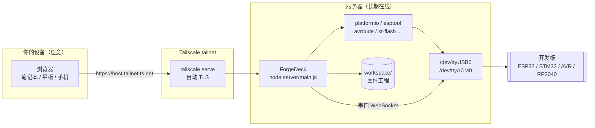
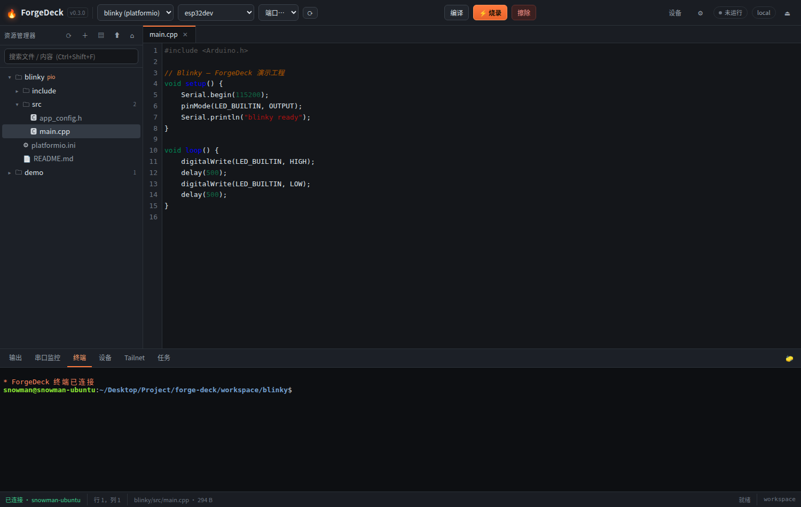

<div align="center">

# 🔥 ForgeDeck

**把插在服务器上的 USB 硬件，变成浏览器里的工作台。**

编辑代码 · 编译 · 烧录固件 · 串口监控 · 交互终端 —— 全部通过 Tailscale 从任意设备访问。

`零 npm 依赖` · `单进程` · `Node ≥ 18` · `MIT`

</div>

---

## 这是什么

ForgeDeck 跑在一台**长期开机、插着开发板**的 Linux 服务器（树莓派、NAS、旧笔记本、云上的裸金属都行）。你在笔记本、平板、手机、借来的电脑上打开浏览器，就能：

- 在服务器的工作区里浏览/编辑工程文件
- 触发 `PlatformIO` / `esptool` / `avrdude` / `st-flash` / `dfu-util` / `arduino-cli` 编译与烧录
- 实时看串口输出、给板子发指令、复位
- 开一个服务器上的 shell，做任何命令行操作
- 一条 `tailscale serve` 之后，从同一 tailnet 的任何设备用 `https://机器名.xxx.ts.net` 打开

> 关键点：**USB 线插在服务器上，不在你手上。** 你在任何带浏览器的设备上操作就行——手机、iPad、公司电脑、朋友的机器都可以。

## 为什么不是"又一个 web IDE"

| | ForgeDeck | 其它 Web IDE |
|---|---|---|
| 定位 | 远端**硬件**工作台 | 远端**代码**编辑器 |
| 烧录 | PlatformIO/esptool/avrdude/st-flash/dfu/openocd/picotool | 通常没有 |
| 串口 | 实时 WebSocket 串口监控 + 发送 | 通常没有 |
| 设备 | USB VID:PID 识别、板卡/调试器型号推断 | 无 |
| 依赖 | 0 个 npm 包 | 一堆 |
| 接入 | Tailscale serve 一条命令，自动 TLS | 自己做反代 |

## 架构



## 五分钟开始

```bash
git clone https://github.com/YOUR_GITHUB/forge-deck.git
cd forge-deck
bash scripts/install.sh          # 生成 config.json（随机令牌）、工作区、可选 systemd
node server/main.js              # 前台跑，默认 http://127.0.0.1:8083
```

在服务器上（同机）先自查：

```bash
curl -s http://127.0.0.1:8083/api/health
FORGEDECK_TOKEN=<你的令牌> node scripts/smoke.js   # 17 项自检
```

然后把它接到 tailnet：

```bash
tailscale serve --bg http://127.0.0.1:8083
tailscale serve status
# 输出里会有 https://<主机名>.<tailnet>.ts.net
```

之后在**任何**加入同一 tailnet 的设备打开那个 https 地址即可。TLS 证书由 Tailscale 自动签发，不用配 nginx。

## 界面

<table>
<tr>
<td width="50%"><br><em>文件树 + CodeMirror 编辑器 + 任务输出</em></td>
<td width="50%"><br><em>服务器上的 PTY 终端（script(1)，无 npm 依赖）</em></td>
</tr>
</table>

## 能力清单

**编辑**
- 文件树（懒加载、右键重命名/删除/下载/另存为）、上传（拖目录内任意路径）、内容搜索
- CodeMirror 5 编辑器：多标签、未保存标记、`Ctrl+S` 保存、C/Python/JS/JSON/YAML/ini/shell/markdown 高亮
- 编辑器组件加载失败时自动降级为纯文本编辑（不会白屏）

**构建与烧录**
- `POST /api/jobs` 统一任务模型：`build` / `flash` / `clean` / `erase` / `custom`
- SSE 实时日志 + 任务历史 + 单任务取消（SIGTERM→SIGKILL）
- 后端自动选择：有 `platformio.ini` → PlatformIO；`.ino` → arduino-cli；`Makefile` → make；也可在"高级烧录"里强制指定
- 直烧后端支持显式 `file` + `address`（如 `esptool write_flash 0x0 firmware.bin`）

**观察**
- 串口：WebSocket 双向、波特率可选、HEX/文本视图、时间戳、`\r\n` 开关、DTR 复位
- 终端：`script(1)` 提供真 PTY（无 npm 依赖），xterm.js 渲染，可 resize
- 设备面板：`/dev/serial/by-id` 稳定路径、sysfs 厂商/产品名、USB VID:PID → 型号猜测（ST-Link/CH340/CP210x/ESP32 原生 USB/Pico/DFU/J-Link…）

**运维**
- `/api/tailnet`：本机 MagicDNS、tailnet IP、在线设备、"一条命令"接入提示
- `/api/backends`：每个烧录器的可用性与实际路径
- 令牌鉴权 + Tailscale WhoIs 身份（可选 allowUsers / allowTags 白名单）

## 支持的烧录后端

| 后端 | 目标 | 触发方式 |
|---|---|---|
| PlatformIO | ESP32/ESP8266/STM32/AVR/RP2040/… | `pio run -t upload` |
| esptool | ESP 系列 | `write_flash <addr> <file.bin>` |
| avrdude | AVR / Arduino | `-U flash:w:<file.hex>:i` |
| st-flash | STM32 (ST-Link) | `write <file.bin> 0x08000000` |
| dfu-util | STM32/Atmel DFU | `-s 0x08000000:leave -D <file>` |
| OpenOCD | 任意 JTAG/SWD | `-f <cfg> -c "program ... verify reset exit"` |
| arduino-cli | Arduino 草图 | `upload -p <port> --fqbn <env>` |
| picotool | RP2040 BOOTSEL | `load <file.uf2>` |
| make | 自定义 Makefile | `make flash` |

装好后端就自动出现在 `/api/backends`；没装的显示灰色不可用，不会误导。

## 安全模型

- **默认只监听 `127.0.0.1`**，对外通过 `tailscale serve` 暴露。不开口到公网。
- **令牌**：`config.json` 的 `token` 或 `FORGEDECK_TOKEN`；登录后写 `HttpOnly` cookie，30 天有效。
- **Tailnet 身份**：开启 `tailscale.whoisAuth` 后，来自 `100.64.0.0/10` 的请求用 `tailscale whois --json` 反查用户/节点；`allowUsers` / `allowTags` 可做白名单。全部留空＝该 tailnet 内任意节点可访问。
- **路径约束**：所有文件操作解析到工作区根目录内，拒绝 `..`、软链、NUL；写入走临时文件 + rename，避免半截文件。
- **命令执行**：全部 `spawn` + 参数数组，不经 shell；`custom` 任务只接受显式 `argv`，`argv[0]` 做字符白名单校验。
- **不希望别人碰 shell？** `config.json` 里 `shell.enabled=false`，或 `serial.allowPorts` 限定可访问的串口。

## 配置

`config.json`（示例见 `config.example.json`）：

```jsonc
{
  "host": "127.0.0.1",        // 想直接局域网访问改 0.0.0.0（务必配 token）
  "port": 8083,
  "workspace": "./workspace", // 相对仓库根或绝对路径
  "token": "…",               // openssl rand -hex 32
  "tailscale": {
    "enabled": true,
    "whoisAuth": true,
    "allowUsers": [],         // 例如 ["you@example.com"]
    "allowTags": [],          // 例如 ["tag:lab"]
    "allowAnyTailnetDevice": true
  },
  "tools": {                   // 留空则从 PATH 找
    "pio": "", "esptool": "", "avrdude": "",
    "stflash": "st-flash", "dfuUtil": "dfu-util", "openocd": "openocd"
  },
  "serial": { "defaultBaud": 115200, "allowPorts": [] },
  "shell": { "enabled": true, "shell": "" },
  "limits": { "uploadMB": 32, "fileMB": 8, "jobsKeep": 30 }
}
```

环境变量优先级更高：`FORGEDECK_TOKEN` / `FORGEDECK_PORT` / `FORGEDECK_HOST` / `FORGEDECK_WORKSPACE` / `FORGEDECK_CONFIG`。

## HTTP API（摘要）

```
GET  /api/health                       存活、版本、pio 可用性
GET  /api/config                       前端需要的公开配置
GET  /api/me                           当前身份（token / tailscale / loopback）
GET  /api/tree?dir=                    单层目录列表
GET  /api/file?path=                   读文件（超限/二进制有标记）
PUT  /api/file                         写文件（临时文件 + rename）
POST /api/fs/{mkdir|touch|rename|delete}
POST /api/fs/upload?path=              原始 body 上传
GET  /api/fs/download?path=            下载
GET  /api/search?q=&dir=               文件名 + 内容搜索
GET  /api/projects                     工程扫描（platformio/arduino/make/cmake/…）
GET  /api/projects/describe?dir=       env 列表与产物
GET  /api/devices                      串口 + USB + 板卡汇总
GET  /api/ports                        可用串口 + 活跃会话
GET  /api/backends                     烧录器可用性
GET  /api/jobs                          任务列表
POST /api/jobs                         {kind, project, env, port, backend, file, address}
GET  /api/jobs/:id                     状态 + 全量日志
GET  /api/jobs/:id/stream              SSE 实时日志
POST /api/jobs/:id/cancel              取消
GET  /api/tailnet                       tailnet 状态与接入命令
WS   /ws/shell?cwd=&cols=&rows=         交互终端
WS   /ws/serial?port=&baud=             串口双向
```

## 目录结构

```
forge-deck/
├── server/            # 零依赖后端
│   ├── main.js        # 路由 + WS 升级
│   ├── ws.js          # 手写 WebSocket（RFC 6455）
│   ├── auth.js        # token + tailscale whois
│   ├── devices.js     # 串口/USB/板卡探测
│   ├── flash.js       # 多后端命令构造
│   ├── jobs.js        # 任务与日志缓冲
│   ├── serial.js      # stty + 非阻塞 fd 串口
│   ├── shell.js       # script(1) PTY
│   ├── fsapi.js       # 文件 API
│   ├── projects.js    # 工程识别
│   └── tailnet.js     # tailscale 状态
├── web/               # 前端（无构建；vendor/ 由 scripts/vendor.sh 生成）
├── scripts/           # install.sh / vendor.sh / smoke.js / forge-deck.service.tpl
├── docs/              # tailscale、后端、开发约定
├── examples/blinky/   # 最小 ESP32 示例工程
└── workspace/         # 你的固件工程放这里（已在 .gitignore 中）
```

## 从零到公开仓库

```bash
cd forge-deck
git init -b main
git add -A
git commit -m "feat: ForgeDeck — remote firmware workbench"

# 用 gh CLI 直接建公开仓库并推送（先把 README 里的 YOUR_GITHUB 换成你的账号）
gh repo create forge-deck --public --source=. --remote=origin --push
```

`.gitignore` 已排除 `config.json`、`workspace/**`、`web/vendor/`，令牌与你的私有工程不会进仓库。

## 常见问题

**板子插在我笔记本上，能用吗？**
不行。ForgeDeck 操作的是**服务器**上的 USB。想本地设备参与，就在那台机器上也跑一个 ForgeDeck 实例（它天然支持），而不是把它当远程 USB 转发。

**`/api/ports` 里没有端口？**
`sudo usermod -aG dialout $USER` 后重新登录；systemd 部署要确认 `SupplementaryGroups=dialout uucp`。容器里跑需要 `--device=/dev/ttyUSB0`。

**`tailscale serve` 打不开页面？**
先确认 `curl http://127.0.0.1:8083/api/health` 通；再 `tailscale serve status`；证书签发有几秒延迟。手机端注意不要开代理绕过 tailnet。

**为什么叫 ForgeDeck？**
`forge`＝锻造/烧录，`deck`＝控制台面板。旧名 `webide` 太泛，搜不到也不说明它是干硬件的。

## 路线图

- [x] 文件编辑 / 编译 / 烧录 / 串口 / 终端 / 设备识别
- [x] Tailscale serve 一键接入 + WhoIs 身份
- [x] 零依赖 WebSocket、PTY、串口
- [ ] 多串口同时监控（标签化）
- [ ] OTA 推送到已联网的板子（HTTP/ESP OTA）
- [ ] 烧录队列与"板卡归还"提醒（多人共用实验室）
- [ ] Web Serial 直连本地板子（浏览器端，作为服务器模式的补充）
- [ ] 一键生成工程模板（ESP32/STM32/Pico）

## License

MIT
